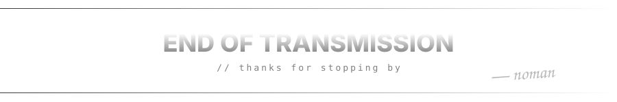

 

<picture>
  <source media="(prefers-color-scheme: dark)" srcset="./mono/snake-dark.svg" />
  <source media="(prefers-color-scheme: light)" srcset="./mono/snake.svg" />
  
</picture>

  

 

